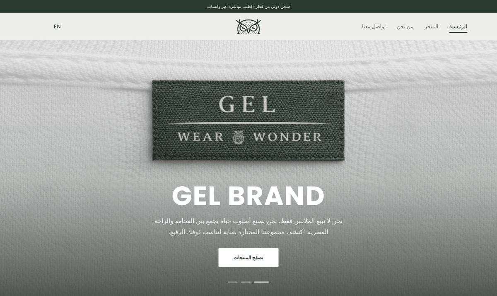
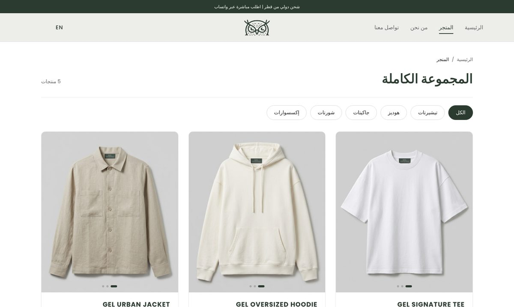
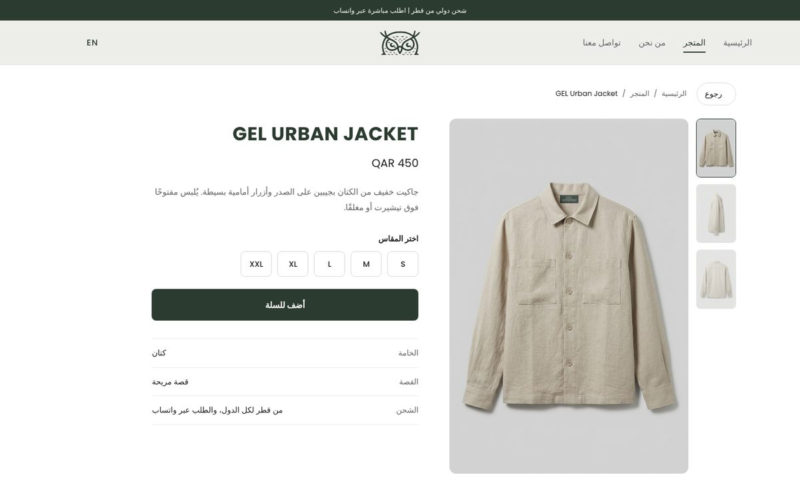
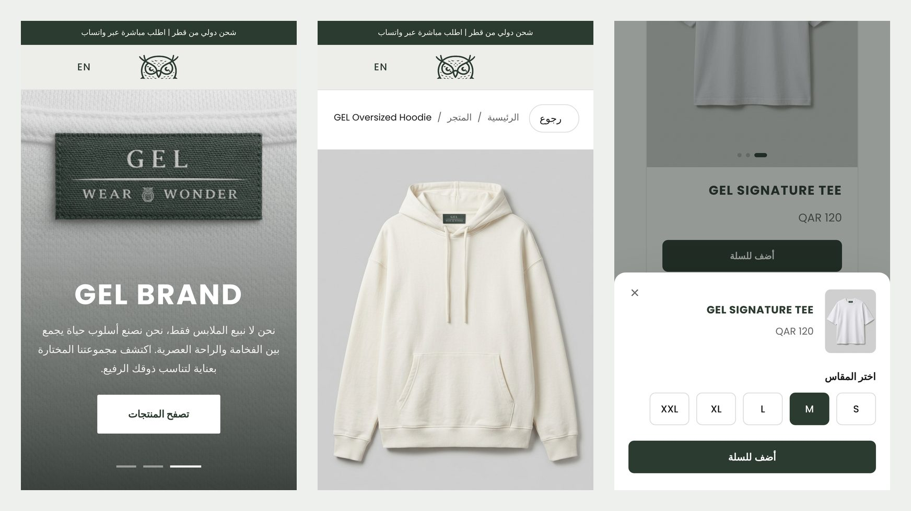

# GEL — Clothing Brand Website

An Arabic-first, bilingual (Arabic / English) storefront for **GEL**, a Qatar-based clothing brand. Customers browse the collection, pick sizes, build a bag, and send the order straight to the brand on WhatsApp. An AI assistant answers questions about products, sizing and ordering.

**Live site:** https://gel-brand.vercel.app



## Features

- **Product catalogue from one source.** Every product (name, price, category, sizes, photos, material, fit, Arabic and English descriptions) lives in `products.js`. The shop cards, product pages and the AI assistant all read from it.
- **Product pages** (`product.html?id=…`): front, side and back photos with thumbnails, a swipeable gallery on phones, hover zoom on desktop and tap-to-zoom on phones, size selection, details and related products.
- **Shop with category filters**, including deep links from the footer (`shop.html#hoodies`).
- **Product cards** that cycle through front, side and back photos on hover (desktop) or while in view (phones).
- **Size picker and bag.** Adding to the bag asks for a size, the bag keeps one line per product and size, and it is saved in `localStorage`.
- **WhatsApp checkout.** Checkout opens WhatsApp with the full order (items, sizes, quantities, totals) written in the visitor's language.
- **AI assistant** powered by Google Gemini, behind a Vercel serverless function so the API key never reaches the browser. It knows the current product list and links product pages in its replies.
- **Arabic and English** with full RTL / LTR switching, remembered between visits.
- **Contact form** via FormSubmit, with a honeypot field against spam and a thank-you message after sending.
- **Responsive and accessible:** sticky frosted header, mobile menu, foldable footer groups on phones, keyboard support in the size picker, and reduced-motion support.

## Screenshots

| Shop | Product page |
| --- | --- |
|  |  |

**On phones:**



## Tech stack

- HTML, CSS and vanilla JavaScript, with no framework and no build step
- Vercel for hosting and the serverless function (`api/chat.js`)
- Google Gemini API for the assistant
- FormSubmit for the contact form
- Font Awesome icons and the Poppins font

## Project structure

```
index.html      Home: hero slider and featured products
shop.html       Full collection with category filters
product.html    Product page (reads ?id= from the URL)
about.html      About the brand
contact.html    Contact options and form
products.js     The product list used by the whole site
main.js         Translations, header, bag, size picker, sliders, product page
style.css       All page styles
ai-chat.*       Chat widget (markup, styles, script)
api/chat.js     Serverless function that calls Gemini with the server-side key
IMG/            Product and brand images
```

## Running locally

The pages are static, so any local server works:

```bash
npx serve .
```

The assistant needs the serverless function. To run it locally, use the Vercel CLI with a Gemini key:

```bash
echo "GEMINI_API_KEY=your-key" > .env
npx vercel dev
```

On Vercel, set `GEMINI_API_KEY` under **Project → Settings → Environment Variables**.

## Adding a product

1. Add the photos to `IMG/` (front, side and back).
2. Add an entry to `GEL_PRODUCTS` in `products.js`.
3. Add its card to `shop.html` (and to `index.html` if it should appear on the home page).

The product page, related products, card photo cycling and the assistant pick it up automatically.
